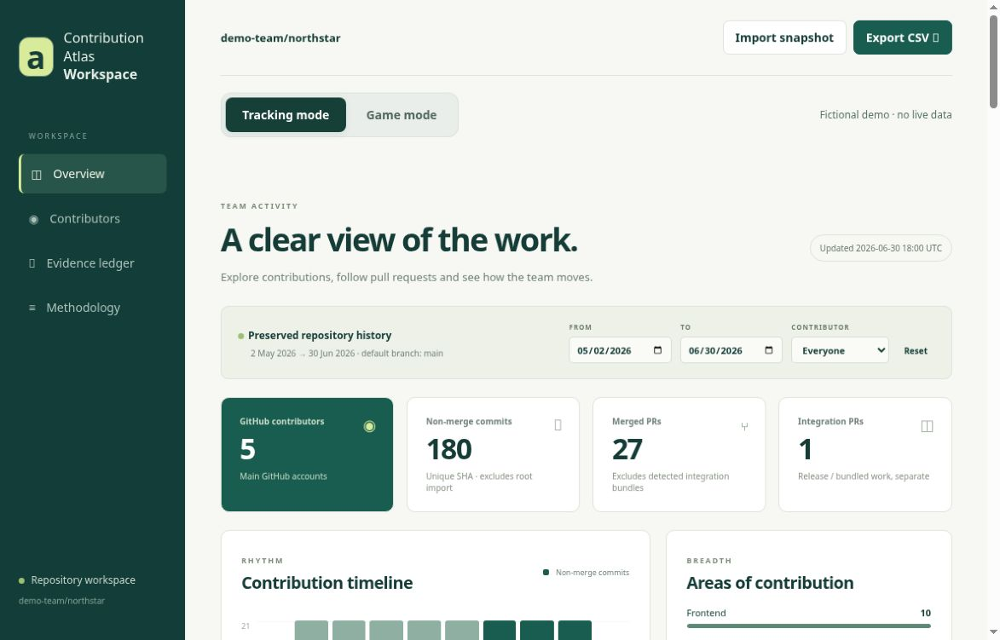
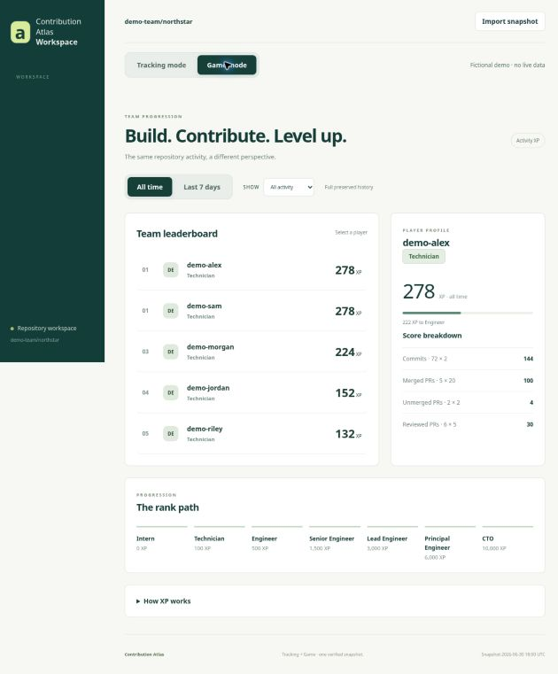

# Contribution Atlas

**A clearer view of GitHub activity—with a little adventure on the side.**

Contribution Atlas turns repository activity into a lightweight, self-hostable dashboard. Use **Tracking** for the facts and optional **Game** mode for playful XP and progression. The same activity powers both views; the game is a conversation starter, not a measure of anyone’s worth or job performance.

- **Your repository, your configuration.** Choose accounts, generated-file patterns, excluded commits, and integration labels.
- **Static by design.** A Python collector writes a JSON snapshot; the browser needs no GitHub token and no backend.
- **Easy to try.** A deterministic, fictional demo runs without credentials.
- **Small footprint.** Node.js 18+ for development/build and Python 3.10+ for collection; no frontend runtime dependencies.

## See it in action

[Open the fictional demo](https://hanster-hub.github.io/contribution-atlas/) · [Try Game mode](https://hanster-hub.github.io/contribution-atlas/#game)

### Tracking: follow the evidence



### Game: a little team competition, with the math in the open



These are actual browser captures of the public fictional demo—not real team records. Switch modes,
explore the seven-day window, and inspect each score. Use it for friendly team rituals, not performance rankings.

## Try it locally

```sh
git clone https://github.com/Hanster-hub/contribution-atlas.git
cd contribution-atlas
npm run demo
npm run build
npm start
```

Open http://localhost:3000. `npm start` serves `public/`; `npm run build` separately prepares `dist/` for deployment. Demo data is fictional: it grants no real awards and makes no claims about real contributors. `npm run demo` replaces `public/data.json`, so keep a copy first if you have already collected a snapshot you want to preserve.

## Use your own repository

1. Edit `atlas.config.json` for your repository and accounts. See [configuration and deployment](docs/deployment.md).
2. Optionally supply a **read-only** GitHub token as the `GITHUB_TOKEN` environment variable in your shell or CI secret store. Public unauthenticated collection has low API limits. Never paste a token into configuration or frontend code.
3. Collect and rebuild:

   ```sh
   python3 scripts/refresh.py
   npm run build
   npm start
   ```

4. Inspect `public/data.json` and the rendered dashboard before publishing the static `dist/` directory.

> **Privacy first:** the bundled collector refuses private repositories. A static snapshot is downloadable by visitors—including any private data supplied through a custom importer. Publish only data you are authorized to share; account display filters are not access control.

## How fresh is the data?

This is a **snapshot dashboard**, not a live GitHub connection. Refresh locally or with the included manual Actions workflow, then rebuild and redeploy. Scheduling is opt-in. The displayed timestamp records when the snapshot changed; an unchanged refresh preserves it, so check workflow logs for the latest collection attempt. See [deployment](docs/deployment.md).

## Tracking and Game

Tracking keeps repository activity readable. Game adds fixed XP rules and rank thresholds, without hiding the underlying counts. XP rewards selected recorded events, not quality, impact, time spent, or work outside GitHub. Reviews, mentoring, design, planning, and many other contributions cannot be reduced to a score.

Read the [methodology](docs/methodology.md) before interpreting or changing the numbers.

## Development

```sh
npm test
npm run demo
npm run build
```

Contributions are welcome. Start with [CONTRIBUTING.md](CONTRIBUTING.md); report sensitive issues using [SECURITY.md](SECURITY.md).

## Documentation

- [Configuration, collection, and deployment](docs/deployment.md)
- [Counting rules, XP, and limitations](docs/methodology.md)
- [Contributing](CONTRIBUTING.md)
- [Security and privacy](SECURITY.md)

## Automation included, publication stays yours

The **Validate** workflow runs tests and builds the fictional demo on pushes and pull requests.
**Collect public snapshot** is a manual GitHub Actions workflow that uses GitHub's short-lived,
read-only job token, collects the configured public repository, and uploads a seven-day artifact.
It does not deploy, commit data, or enable a schedule. Review your configuration and audience before
adding recurring collection or hosting. See [deployment](docs/deployment.md).

## License

MIT — use it, adapt it, and build something your team enjoys. See [LICENSE](LICENSE).

### Refresh the fictional Pages demo

`npm run build:demo` regenerates `docs/index.html` from the app and deterministic demo generator.
It never collects GitHub data. The bundled Pages demo is a standalone fictional preview, separate
from the real snapshots you collect under `public/`. Enable GitHub Pages from `main` → `/docs`
for that preview only; do not copy real collected snapshots into this demo without reviewing them.
